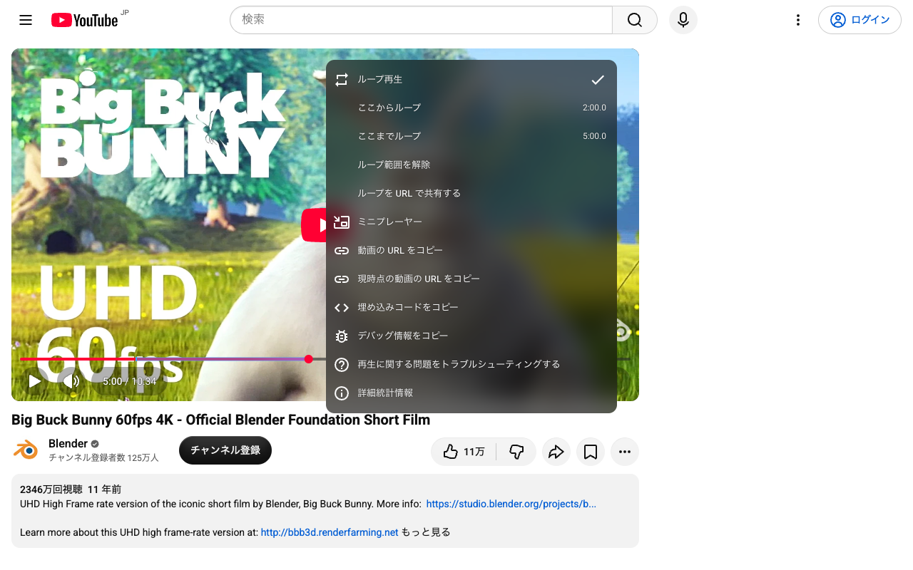

# yt-loop

YouTube の動画の指定した範囲 (A〜B) を繰り返し再生する Chrome 拡張 (Manifest V3)。
楽器・ダンス・語学の練習で、同じ箇所を何度も聴き直す用途を想定している。

YouTube のプレイヤーを右クリックしたときに出る標準のメニュー (「ループ再生」がある所) を拡張する。
画面に新しいパネルは足さない。



## できること

プレイヤーの右クリックメニューの「ループ再生」の下に、次の項目を足す。

| 項目 | 動作 |
| --- | --- |
| ここからループ | 右クリックした時点の再生位置を A (開始) にする。右に記録済みの A を出す |
| ここまでループ | 右クリックした時点の再生位置を B (終了) にする。右に記録済みの B を出す |
| ループ範囲を解除 | A と B を消す。A か B が記録されているときだけ出す |
| ループを URL で共有する | 今の範囲を載せた URL (下記) をクリップボードへ写す。範囲がそろっているときだけ出す |

- **ON / OFF は標準の「ループ再生」をそのまま使う。** A と B が記録されていて「ループ再生」にチェックが入っている間、A〜B を繰り返す。チェックを外せば普通に再生する。範囲が無いときの「ループ再生」は YouTube 標準のまま (動画全体のループ)
- A と B を初めて両方そろえたとき、「ループ再生」を自動でオンにする
- プレイヤーのシークバーにループ範囲を帯で重ねる (オフの間は薄く出す)
- 範囲と「ループ再生」のオン / オフを **URL ごとに** 覚える (`chrome.storage.local`)。同じ URL を開き直すと前の範囲とオン / オフが戻る。URL は動画 ID (`watch?v=` の値) で見分け、`t=` (再生位置) や `list=` (再生リスト) の違いは同じ URL として扱う

## URL でループを指定する

URL のクエリで範囲を指定できる。1 つの動画に範囲は 1 つしか覚えないので、複数の範囲を使い分けたいときはこの URL をブックマークしておく。

```
https://www.youtube.com/watch?v=vzQcOVGZEig&t=12234s&yt-loop-start=12234&yt-loop-end=12250
```

| クエリ | 意味 |
| --- | --- |
| `yt-loop-start` | A (秒。小数可) |
| `yt-loop-end` | B (秒。小数可) |
| `t` | YouTube 標準の再生開始位置。共有用の URL には A の整数秒を入れる。**拡張が入っていない人にも、ループではなく A から再生されるリンクとして働く** |

- この URL を開くと、範囲を URL の値にし、「ループ再生」をオンにする。その動画で覚えていた範囲は URL の値で上書きする (開き直しても同じ範囲になるように)
- 2 つがそろって `B - A >= 0.2 秒` のときだけ受け付ける。片方だけ・読めない値・短すぎる範囲は無視して、覚えていた範囲を使う
- 共有用の URL の秒数は 0.1 秒単位に丸める (`12.30` は `12.3`、`12.0` は `12`)
- 共有用の URL には `v` と `t` と 2 つのクエリだけを載せる (`list=` などは外す)

## 動作の決まり

- ループは A と B の両方が決まり、`B - A >= 0.2 秒` のときだけ効く
- 「ここからループ」は常に押せる。B 以降に置いたら B を消す (A から決め直す操作)
- 「ここまでループ」は A より 0.2 秒以上後でなければ押せない (薄く表示して押しても何もしない)
- A と B には**右クリックした時点**の再生位置を使う。メニューを開いている間も動画は進むので、項目を押した時点の位置ではない
- **再生が B をまたいだら A へ戻す。シークで飛んだ先は戻さない。**
  - A の手前へシークすると、そこから流れて範囲に入る (前奏から入りたい場合のため)
  - B より後へシークすると (シークバー・タイムスタンプのリンクなど)、ループを抜けてそこから普通に再生する。範囲の中へシークし直せば、また B で戻る
  - 「ここまでループ」を押したときにもう B を過ぎていたら (メニューを開いている間も動画は進む)、その場で A へ戻す
- A へ戻すときは YouTube 自身のシーク (`movie_player.seekTo`) を使う (下記)
- B が動画の末尾に近い場合は、末尾の 0.25 秒手前で折り返す。末尾まで行くと標準のループが動画の先頭へ戻してしまうため
- 広告の再生中 (`#movie_player.ad-showing`) は何もしない
- 再生位置の見張りは `requestAnimationFrame` (タブが見えている間の精度) と `timeupdate` (背景タブでも届く。約 250ms 間隔) の両方で行う。背景タブでは B を最大 250ms ほど過ぎてから戻ることがある
- 別の動画へ移ったら、その URL で覚えた範囲を読み直す。覚えていればオン / オフも戻す。覚えていなければ「ループ再生」には触らない

## 実装上の注意 (YouTube の右クリックメニュー)

2026-10 時点の実測。

- メニュー (`.ytp-popup.ytp-contextmenu`) は最初の右クリックで作られる。それまで DOM に無い
- 標準「ループ再生」は `.ytp-menuitem[role=menuitemcheckbox]` で、`video.loop` と連動する。`video.loop` を直接書き換えると、次に開いたときのチェック表示も追従する
- メニューの高さはポップアップ・`.ytp-panel`・`.ytp-panel-menu` にインラインで固定されている。項目を足したら 3 つとも高さを直す
- 項目を足して高くなったメニューを、YouTube は 2 回目以降の右クリックでどこを押しても画面の上端 (`top:0`) に置く。足さない素の状態では押した位置に出るので、縦の位置は拡張が右クリックした位置に置き直す
- 閉じるには Escape を送る。`display:none` で隠すと YouTube の内部状態は「開いている」ままで、次の右クリックで開かなくなる

## 実装上の注意 (シーク)

- **`video.currentTime` を直接書き換えてシークしない。** YouTube が自分でシークしている最中 (タイムスタンプのリンクを踏んだ直後など) に書き換えると、YouTube の思っている位置と動画の位置がずれ、読み込み中のまま止まる (2026-10 に実機で発生)
- `movie_player.seekTo` はページの JavaScript (main world) にしか見えない。main world で動く小さな content script (`src/main-world/seek-bridge.ts`) を置き、拡張の側 (isolated world) からは DOM のイベントで頼む。橋が見つからないときだけ `video.currentTime` を直接書き換える

## 実装上の注意 (URL のクエリ)

- **YouTube は読み込みの途中で知らないクエリを URL から消す** (`domcontentloaded` の時点では残っていて、動画が読み込まれた後には無い。2026-10 の実測)。そのため content script は `document_start` で動かし、起動した時点で URL を読む
- YouTube の中のリンクを押した移動 (SPA 遷移) ではページを読み込み直さないので、リンクのクリックを捕まえてその URL から読む
- メニューの項目を押した操作の中で、`navigator.clipboard.writeText` でクリップボードへ書き込む。追加の権限は要らない

## 必要な権限

| 権限 | 理由 |
| --- | --- |
| `storage` | URL ごとの範囲を覚える |
| content script `https://www.youtube.com/*` | メニューの項目とシークバーの帯を差し込む。YouTube の中の移動は SPA なので `/watch` に絞らない (動画ページ以外では何もしない) |

## 開発

```sh
npm install
npm run build      # dist/ にビルド
npm test           # 単体テスト (vitest)
npm run typecheck
npm run icons      # public/icons/ を描き直す (Playwright の Chromium を使う)
npm run package    # ストアへ上げる zip を release/ に作る
npm run screenshots # ストア掲載用のスクリーンショットを release/screenshots/ に撮る
```

Chrome の `chrome://extensions` でデベロッパーモードをオンにし、「パッケージ化されていない拡張機能を読み込む」で `dist/` を選ぶ。

ストアへの公開手順は [docs/store-release.md](docs/store-release.md)、プライバシーポリシーは [docs/privacy-policy.md](docs/privacy-policy.md)。

## 構成

| ファイル | 役割 |
| --- | --- |
| `src/content/youtube.ts` | content script の入口。SPA 遷移の追従、ループの見張り、URL ごとの状態の読み書き |
| `src/content/context-menu.ts` | 右クリックメニューへの項目の差し込み |
| `src/content/progress-band.ts` | シークバーに重ねる帯 |
| `src/main-world/seek-bridge.ts` | ページの側 (main world) で YouTube のシークを呼ぶ橋。content script とモジュールを共有しない (共有するとビルドが非同期のローダー経由に変える) |
| `src/content/toast.ts` | プレイヤーの上に短く出す知らせ (URL をコピーしたとき) |
| `src/content/selectors.ts` | YouTube の DOM セレクタの集約 |
| `src/shared/loop.ts` | 範囲の検査・折り返し判定などの純粋な関数 (テスト対象) |
| `src/shared/time.ts` | 時刻の整形 |
| `src/shared/share-url.ts` | URL のクエリの読み取りと共有用の URL の組み立て |
| `src/shared/storage.ts` | URL ごとの範囲の保存と読み込み |

参考: [yt-clip](https://github.com/trapple/yt-clip) (同じ作者の切り抜き拡張。SPA 追従とシークバーの帯の作り方を踏襲)
